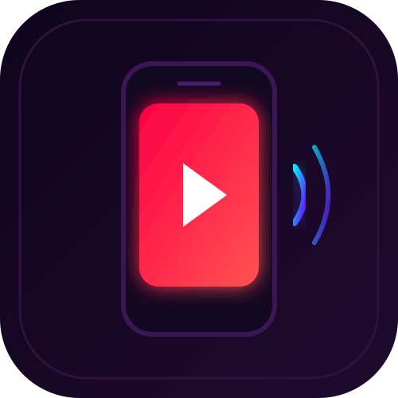

  

# Shorts Studio Pro & Sensory Video Generator

> Automated video generation pipeline for viral YouTube Shorts (fake chat format) and infant sensory visual stimulation videos.

## 🚀 Features
- **Shorts Studio UI:** Streamlit web interface with Casting, Script Editor, Director, and Export controls.
- **Fake Chat Formats:** Generates frame-by-frame scrolling WhatsApp and Roblox chat dialogues with realistic typing indicators.
- **Neural Voiceovers:** Synchronized Edge-TTS voices with pitch adjustment and bilingual (Telugu/English) script parsing.
- **Infant Sensory Mode:** Algorithmic 1-hour baby sensory video generator (`generate_1hr_sensory_video.py`) with high-contrast shapes and calming lullabies.

## 🛠️ Tech Stack
- Python 3.10+
- Streamlit, MoviePy, FFMPEG
- Edge-TTS, Pillow, NumPy
